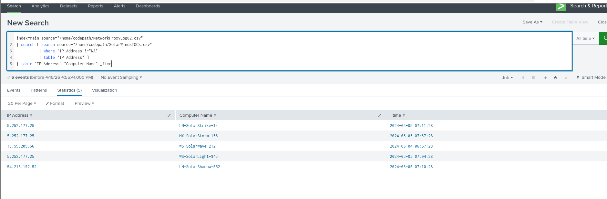
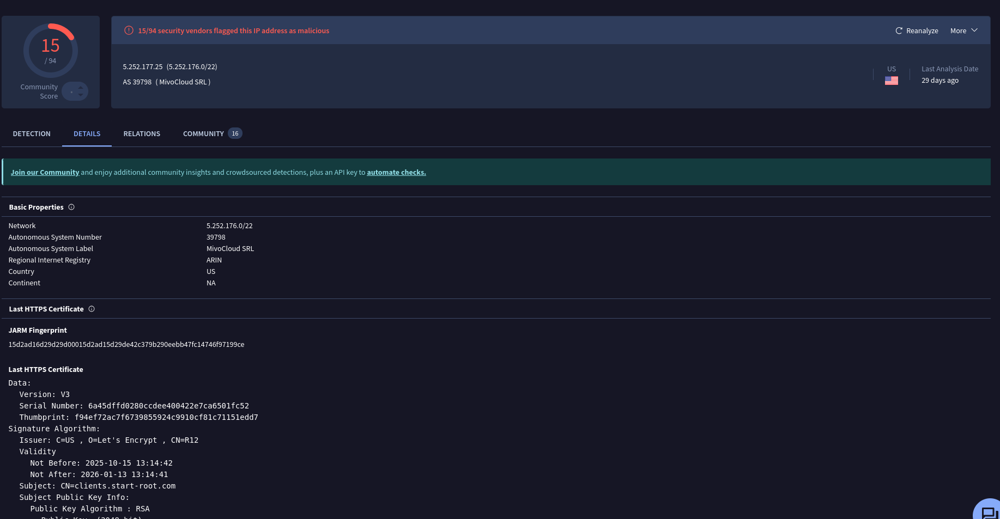
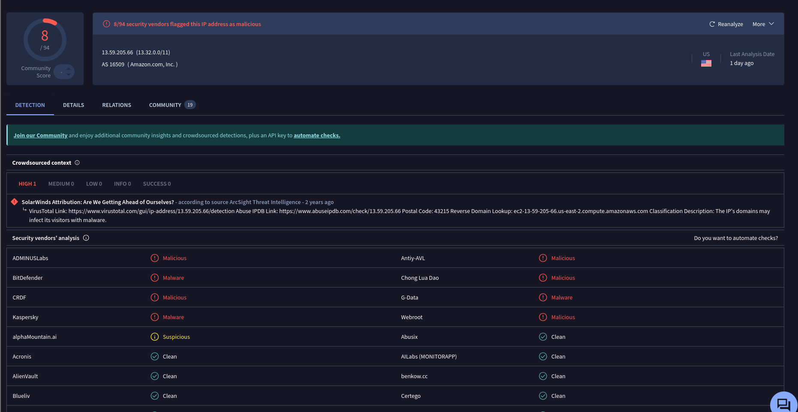
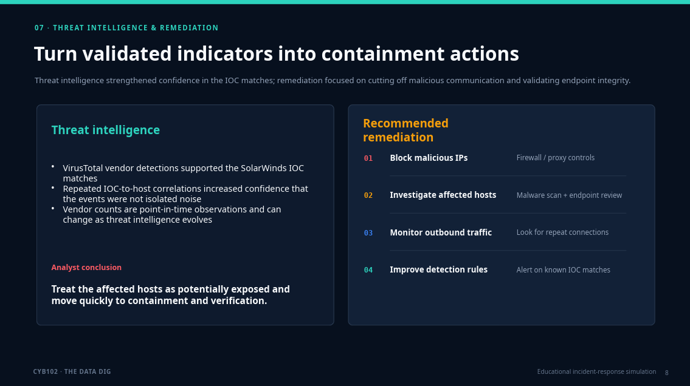
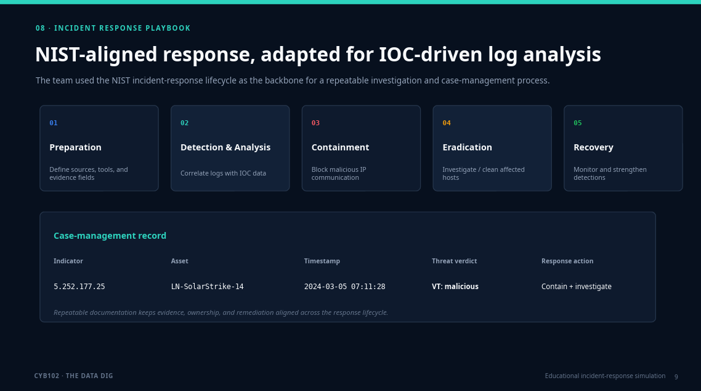
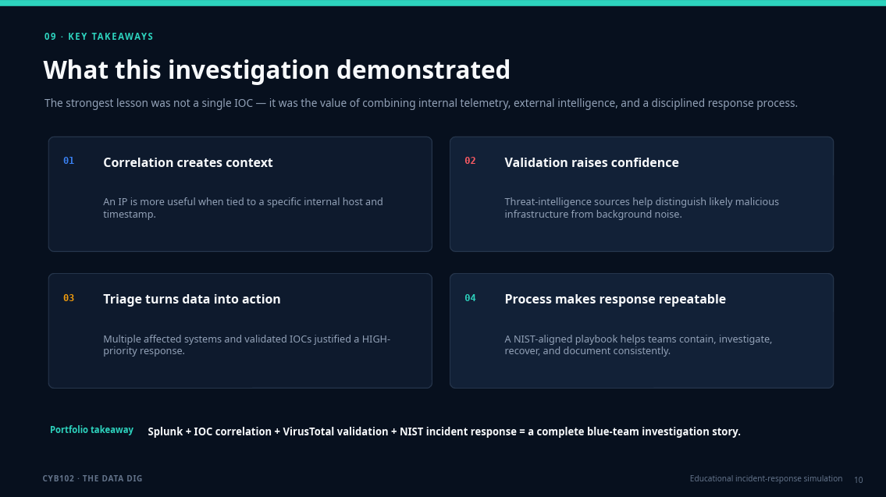
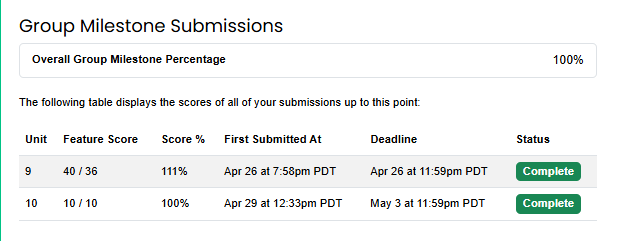

# SolarWinds IOC Investigation


Cybersecurity capstone investigating potential exposure to SolarWinds-related malicious infrastructure using **Splunk**, **VirusTotal**, network proxy logs, Indicators of Compromise (IOCs), and the **NIST Incident Response Framework**.

## Project Overview

This project was completed as part of the **CodePath CYB102 Cybersecurity Capstone: The Data Dig**.

The investigation analyzed internal network proxy logs and compared them against a dataset of known SolarWinds Indicators of Compromise. The goal was to identify internal systems that communicated with suspicious infrastructure, validate those indicators using external threat intelligence, assess potential impact, and recommend appropriate response actions.

> This project identifies evidence of communication with known malicious infrastructure. It does not claim that the affected systems were definitively compromised.

## Tools and Technologies

- **Splunk Enterprise** — log ingestion, searching, filtering, and IOC correlation
- **VirusTotal** — external threat-intelligence validation
- **Network Proxy Logs** — internal network activity
- **SolarWinds IOC Dataset** — known suspicious and malicious indicators
- **NIST SP 800-61 Incident Response Framework** — response methodology

## Investigation Method

The investigation followed this workflow:

1. Imported the SolarWinds IOC dataset and network proxy logs into Splunk.
2. Extracted valid IP addresses from the IOC dataset.
3. Correlated IOC IP addresses with internal network traffic.
4. Identified systems communicating with suspicious IP addresses.
5. Validated matched indicators using VirusTotal.
6. Assessed affected assets and potential security impact.
7. Developed containment and remediation recommendations.
8. Documented findings using a customized incident-response playbook.



## Key Findings

### Finding 1 — IOC Match: 5.252.177.25

Splunk correlation identified communication between the SolarWinds IOC `5.252.177.25` and the internal system:

- **System:** `LN-SolarStrike-14`
- **Timestamp:** `2024-03-05 07:11:28`

VirusTotal showed that the IP was flagged as malicious by multiple security vendors.



### Finding 2 — IOC Match: 13.59.205.66

A second IOC match identified communication between `13.59.205.66` and:

- **System:** `WS-SolarWave-212`
- **Timestamp:** `2024-03-04 06:57:28`

The indicator was also flagged by multiple vendors in VirusTotal.



## Impact Analysis and Triage

The analysis showed that multiple internal systems communicated with IP addresses contained in the SolarWinds IOC dataset.

Because the indicators were also flagged by external threat-intelligence sources, the affected systems were prioritized for further investigation and containment.



## Threat Intelligence and Remediation

Threat intelligence was used to strengthen the investigation by validating identified indicators against VirusTotal.

Recommended response actions included:

- Block identified malicious IP addresses at the firewall level
- Investigate affected systems for signs of compromise
- Monitor outbound network traffic for additional suspicious activity
- Improve detection and alerting capabilities
- Preserve investigation evidence and timestamps for incident tracking



## Incident Response Framework

The investigation followed the **NIST Incident Response Framework**, adapted for IOC-driven network analysis.

The customized workflow focused on:

**Data Collection → IOC Extraction → Log Correlation → Threat Validation → Impact Analysis → Containment → Investigation & Monitoring → Documentation**



## Custom Incident Response Playbook

A customized SolarWinds IOC investigation playbook was developed for the project.

It adapts the NIST incident-response process specifically for:

- Splunk-based network log analysis
- IOC matching
- VirusTotal validation
- Asset identification
- Incident severity assessment
- Containment and monitoring
- Investigation documentation

[View the Custom SolarWinds IOC Investigation Playbook](Documentation/Custom-SolarWinds-IOC-Investigation-Playbook.pdf)

## Project Presentation

The complete professional presentation is available in both formats:

- [PowerPoint Presentation](Presentation/SolarWinds-IOC-Investigation-Professional.pptx)
- [PDF Presentation](Presentation/SolarWinds-IOC-Investigation-Professional.pdf)

## Additional Documentation

- [CYB102 Capstone Submission](Documentation/CYB102-Capstone-Submission.pdf)
- [SolarWinds Threat Detection One-Pager](Documentation/SolarWinds-Threat-Detection-One-Pager.pdf)
- [Custom SolarWinds IOC Investigation Playbook](Documentation/Custom-SolarWinds-IOC-Investigation-Playbook.pdf)

### Capstone Completion

The team completed both capstone milestones:

- **Unit 9:** 40/36 — 111%
- **Unit 10:** 10/10 — 100%
- **Overall Group Milestone Completion:** 100%



## Skills Demonstrated

- Security log analysis
- Indicators of Compromise (IOC) analysis
- Splunk search and correlation
- Threat intelligence validation
- Network traffic investigation
- Incident triage
- Impact assessment
- Incident response planning
- NIST incident-response methodology
- Security documentation
- Cybersecurity presentation and communication

## Repository Structure

```text
solarwinds-ioc-investigation/
├── Documentation/
│   ├── CYB102-Capstone-Submission.pdf
│   ├── Custom-SolarWinds-IOC-Investigation-Playbook.pdf
│   ├── SolarWinds-Threat-Detection-One-Pager.pdf
│   └── capstone-completion-and-grades.png
├── Presentation/
│   ├── SolarWinds-IOC-Investigation-Professional.pdf
│   └── SolarWinds-IOC-Investigation-Professional.pptx
├── Screenshots/
│   ├── impact-analysis-triage.png
│   ├── investigation-method-splunk.png
│   ├── ioc-match-5-252-177-25.png
│   ├── ioc-match-13-59-205-66.png
│   ├── nist-playbook-case-management.png
│   ├── solarwinds-ioc-investigation-banner.png
│   └── threat-intelligence-remediation.png
└── README.md
```
## Team

This project was completed as a **CYB102 group capstone**.

**Project Lead:** Hamzah

**Team Members:** Yifan, Hamzah, Jessica, Daksh, and Jeiss.